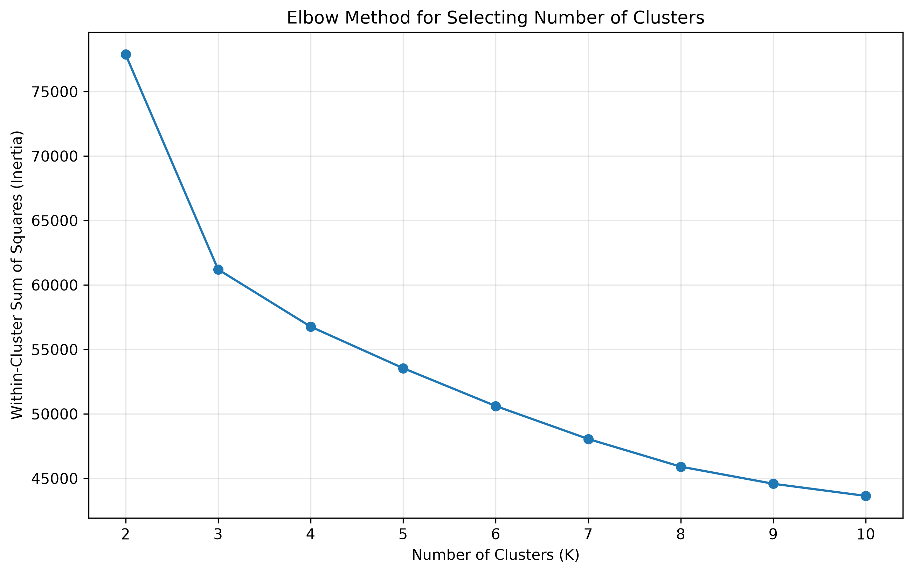
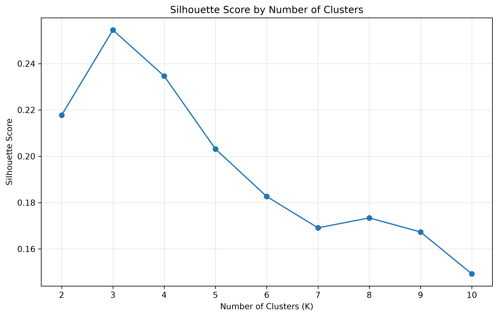
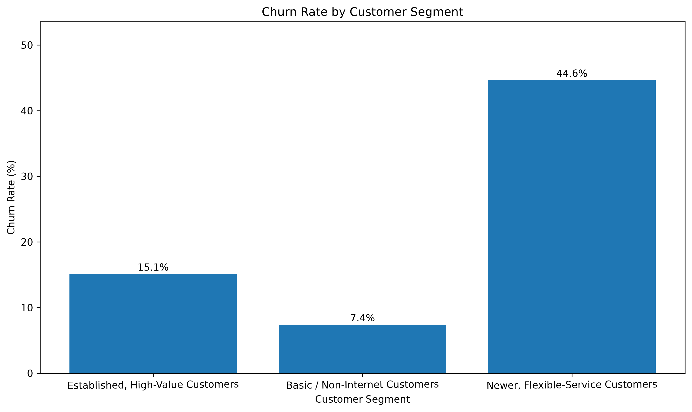
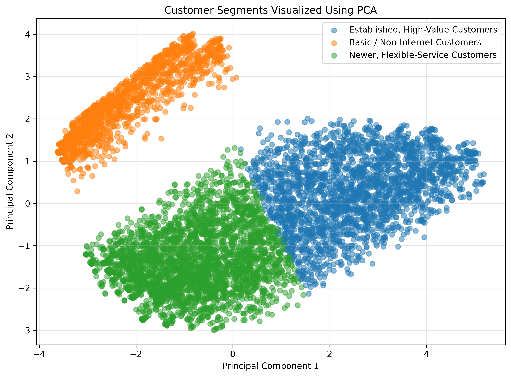
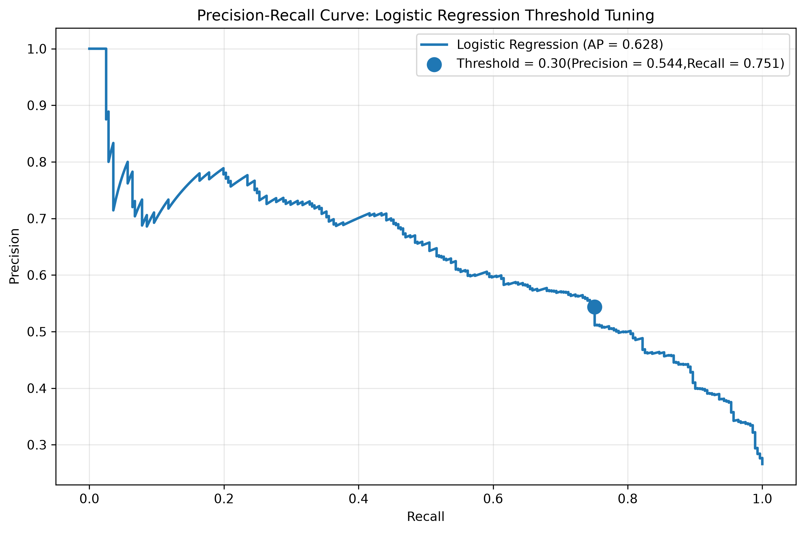
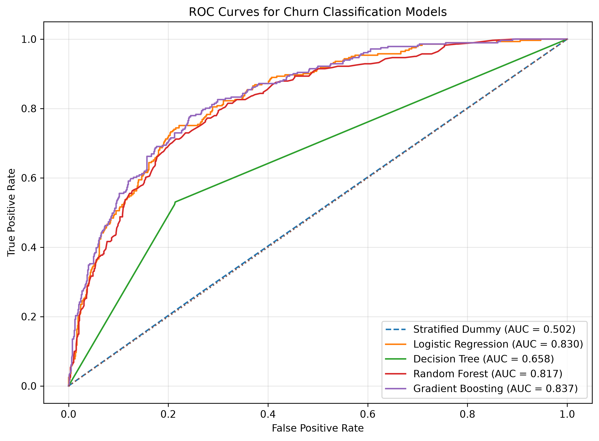
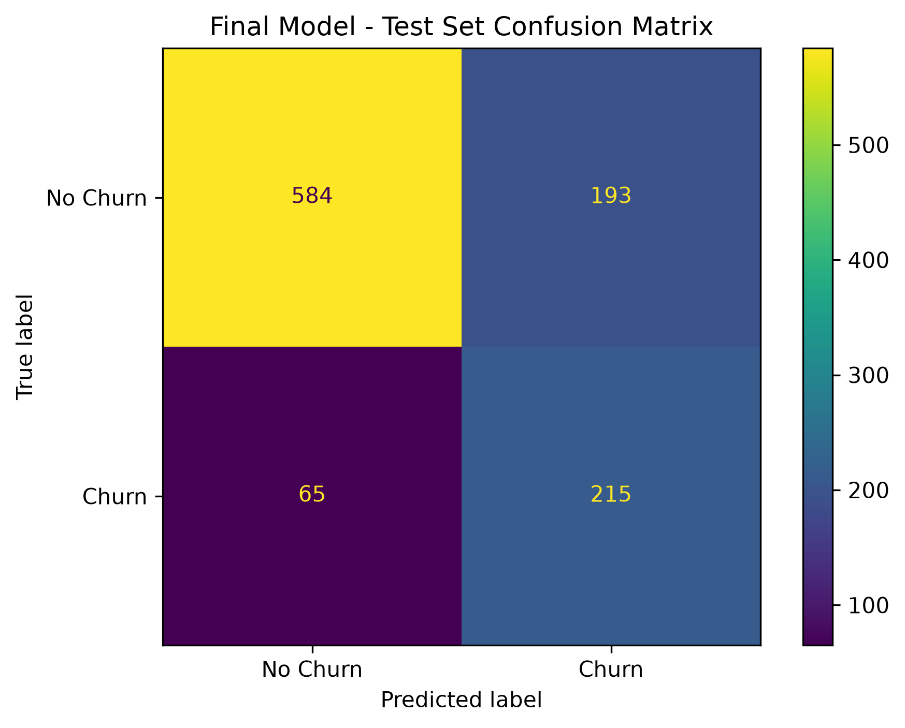

# Telco Customer Churn Analysis and Prediction

## Project Overview

This project applies data analytics and machine learning to understand customer churn in the telecommunications industry. Using the Telco Customer Churn dataset sourced from Kaggle, the analysis combines exploratory data analysis, SQL, feature engineering, unsupervised learning, and supervised classification to identify customer segments and predict customer churn.

The project explores two complementary business questions:

1. **Customer segmentation:** What distinct customer groups can be identified from customer characteristics and service usage?
2. **Churn prediction:** Which customers are more likely to discontinue their services?

The objective is to translate the analytical findings into actionable insights that could support customer retention planning and data-driven decision-making.

## Business Problem

Customer churn can affect revenue, customer lifetime value, and long-term business growth. Understanding the characteristics associated with churn can help organisations identify customers who may need additional engagement and develop more informed retention strategies.

This project investigates customer behaviour, service subscriptions, contract arrangements, payment methods, and billing characteristics to understand their relationship with observed churn.

## Dataset

- **Dataset:** Telco Customer Churn
- **Source:** [Kaggle — Telco Customer Churn](https://www.kaggle.com/datasets/blastchar/telco-customer-churn)
- **Records:** 7,043 customers
- **Original features:** 21 columns
- **Target variable:** `Churn`
- **Positive class:** `Yes` — customer churned
- **Overall churn rate:** 26.54%

The notebook downloads the dataset directly from Kaggle, supporting reproducibility without depending on a manually uploaded local CSV file.

## Tools and Technologies

- **Python:** Data analysis and machine learning
- **Pandas and NumPy:** Data manipulation and numerical analysis
- **Matplotlib and Seaborn:** Data visualization
- **SQLite:** SQL-based data exploration
- **Scikit-learn:** Preprocessing, clustering, classification, and model evaluation
- **Imbalanced-learn:** SMOTE-based imbalance handling
- **KaggleHub:** Dataset acquisition from Kaggle
- **Jupyter Notebook:** Development and execution environment

## Project Workflow

The analysis follows a structured seven-part workflow:

1. **Data Foundation:** Dataset acquisition, data inspection, cleaning, exploratory analysis, and SQL queries.
2. **Feature Engineering and Encoding:** Creation of additional features, categorical encoding, and numerical scaling.
3. **Clustering Analysis:** K-Means clustering, elbow analysis, silhouette evaluation, customer profiling, and PCA visualization.
4. **Classification:** Evaluation of multiple classification algorithms against a stratified dummy baseline, including cross-validation and feature-importance comparison.
5. **Imbalance Handling:** Comparison of class weighting, SMOTE, and classification-threshold tuning using precision, recall, F1 score, and ROC AUC.
6. **The Tie-In:** Analysis of observed churn rates across the independently developed customer segments.
7. **Conclusion and Recommendations:** Model selection, interpretation of findings, limitations, and potential business applications.

## Key Findings

### 1. Customer Segmentation

K-Means clustering was evaluated for values of K from 2 to 10. Both the elbow curve and silhouette analysis supported selecting three clusters.

**K-Means Elbow Curve**

**K-Means Silhouette Score**

The resulting customer segments were:

| Customer Segment | Customers | Share of Dataset |
|---|---:|---:|
| Established, High-Value Customers | 2,394 | 33.99% |
| Basic / Non-Internet Customers | 1,526 | 21.67% |
| Newer, Flexible-Service Customers | 3,123 | 44.34% |

### 2. Churn Differences Across Segments

The clusters exhibited substantially different observed churn rates.

| Customer Segment | Observed Churn Rate | Difference vs. Overall |
|---|---:|---:|
| Established, High-Value Customers | 15.12% | -11.42 percentage points |
| Basic / Non-Internet Customers | 7.40% | -19.13 percentage points |
| Newer, Flexible-Service Customers | 44.64% | +18.10 percentage points |
| **Overall** | **26.54%** | — |

**Churn Rate By Customer Segment**

The Newer, Flexible-Service Customers segment had the highest observed churn rate. This finding illustrates how customer segmentation can provide a complementary perspective to individual churn prediction.

These results represent observed associations and do not establish that segment membership causes churn.

**PCA Visualization**

### 3. Classification Model Performance

Multiple classifiers were evaluated, including Logistic Regression, Decision Tree, Random Forest, and Gradient Boosting. A Stratified Dummy Classifier was used as the baseline.

The selected model was Logistic Regression with a classification threshold of 0.30, chosen using validation data.

**Precision Recall Curve**

**Final test-set performance:**

| Metric | Result |
|---|---:|
| Accuracy | 75.59% |
| Precision | 52.70% |
| Recall | 76.79% |
| F1 Score | 62.50% |
| ROC AUC | 85.03% |

The final model achieved an F1 score of 0.6250, compared with 0.2679 for the dummy baseline, and a ROC AUC of 0.8503.

**ROC Curves for Churn Classification Models**

At the selected threshold, the model identified 215 of the 280 actual churners in the test set, while missing 65. It also generated 193 false-positive churn predictions. These results illustrate the trade-off between detecting churners and generating unnecessary retention alerts.

**Final Model Confusion Matrix**

The threshold reflects a modelling assumption that missing a genuine churner is more costly than contacting a customer who ultimately does not churn. A production deployment would require further evaluation using actual business costs.

## Business Recommendations

Based on the findings, potential next steps include:

- Investigate the reasons behind the elevated observed churn rate among Newer, Flexible-Service Customers.
- Explore retention interventions for customers with high predicted churn probabilities.
- Evaluate contract arrangements, tenure, billing characteristics, and service adoption as potential indicators for further investigation.
- Use customer segments to support differentiated analysis while using the classification model to prioritise individual customers.
- Monitor model performance and recalibrate the classification threshold as actual retention costs and outcomes become available.

These recommendations are hypotheses for further business investigation, not proven causal interventions.

## Reproducibility

The notebook is designed to execute from beginning to end in a fresh runtime and retrieves the dataset directly from Kaggle.

To reproduce the analysis:

1. Open the notebook in Google Colab or a compatible Jupyter environment.
2. Install or import the required dependencies as specified in the notebook.
3. Ensure Kaggle dataset access is available if authentication is requested.
4. Run all notebook cells sequentially.
5. Review the generated tables, visualizations, clustering results, and classification metrics.

The completed notebook was successfully tested after a kernel restart, executing all 149 cells in approximately 235 seconds in the tested Jupyter and Google Colab environments. Actual runtime may vary by environment.

## Limitations

- The analysis uses a single dataset and does not establish that the findings generalise to every telecommunications business.
- The observed cluster churn rates describe associations rather than causal effects.
- The classification threshold was selected using a stated business-cost assumption rather than verified intervention-cost data.
- The model would require further validation, probability calibration, monitoring, and business evaluation before production deployment.

## Project Deliverable

The principal deliverable is an end-to-end Jupyter notebook covering data preparation, exploratory analysis, customer segmentation, churn classification, model evaluation, and business recommendations.

## Acknowledgements

Dataset: [Telco Customer Churn — Kaggle](https://www.kaggle.com/datasets/blastchar/telco-customer-churn).

This project was completed as part of TSA data science capstone project.
